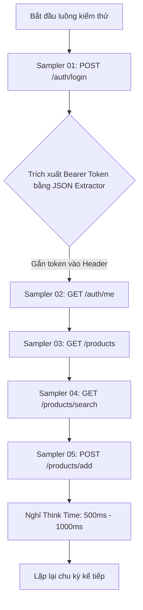
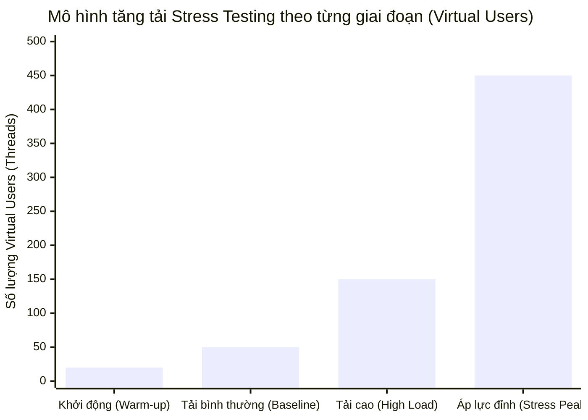
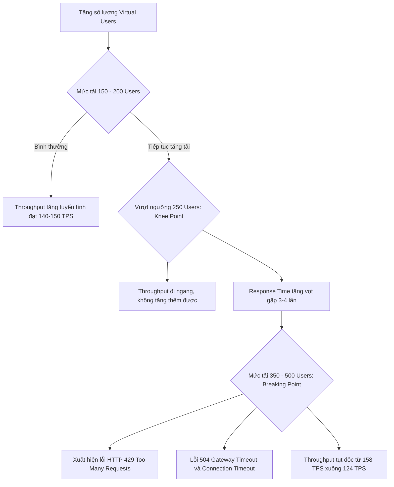

# BÁO CÁO KIỂM THỬ ÁP LỰC (STRESS TESTING) REST API BẰNG APACHE JMETER

---

## 1. MỤC TIÊU VÀ PHẠM VI KIỂM THỬ (OBJECTIVES & SCOPE)

### 1.1. Mục tiêu kiểm thử
1. **Xác định ngưỡng chịu tải tối đa (Knee Point / Saturation Point):** Tìm ra số lượng người dùng đồng thời (Virtual Users) mà hệ thống có thể xử lý ổn định trước khi hiệu năng bắt đầu suy giảm.
2. **Tìm điểm gãy của hệ thống (Breaking Point):** Ép tải tăng dần để quan sát tại thời điểm nào hệ thống bắt đầu phát sinh lỗi (HTTP 500, 502, 504, 429 hoặc Connection Timeout).
3. **Đo lường các chỉ số hiệu năng cốt lõi:**
   - **Throughput (TPS):** Số lượng giao dịch / yêu cầu xử lý thành công trên mỗi giây.
   - **Response Time (Thời gian phản hồi):** Giá trị trung bình (Average), trung vị (Median), và các phân vị trọng yếu 90th, 95th, 99th Percentile.
   - **Error Rate (% lỗi):** Tỷ lệ phần trăm các request thất bại khi chịu áp lực cao.
4. **Đánh giá khả năng tự phục hồi (Recovery):** Kiểm tra xem khi giảm tải, hệ thống có tự ổn định trở lại về mức phản hồi bình thường hay không.

### 1.2. Tiêu chuẩn cam kết dịch vụ (SLA - Service Level Agreement)
Hệ thống được đánh giá là đạt chuẩn khi đáp ứng các tiêu chí sau trong điều kiện tải thông thường đến tải cao:

| Chỉ số (Metric) | Mức chấp nhận (SLA Target) | Mức cảnh báo (Warning) | Mức không đạt (Fail) |
| :--- | :--- | :--- | :--- |
| **Response Time (Trung bình)** | $\le 1000\text{ ms}$ | $1000\text{ ms} - 2500\text{ ms}$ | $> 2500\text{ ms}$ |
| **95th Percentile** | $\le 2000\text{ ms}$ | $2000\text{ ms} - 4000\text{ ms}$ | $> 4000\text{ ms}$ |
| **Throughput** | $\ge 120\text{ requests/sec}$ | $80 - 120\text{ req/sec}$ | $< 80\text{ req/sec}$ |
| **Tỷ lệ lỗi (Error Rate)** | $\le 1.0\%$ | $1.0\% - 5.0\%$ | $> 5.0\%$ |

---

## 2. MÔI TRƯỜNG VÀ CÔNG CỤ (TEST ENVIRONMENT)

### 2.1. Cấu hình máy kiểm thử (Client Generator)
* **Hệ điều hành:** Windows 10/11 64-bit
* **CPU:** Intel/AMD Multi-core $\ge 4$ Cores
* **RAM:** 16 GB (Cấu hình JVM Heap Size cho JMeter: `-Xms2g -Xmx4g`)
* **Java Runtime:** OpenJDK 17+

### 2.2. Thông tin hệ thống mục tiêu (Server Under Test)
* **Host:** `dummyjson.com`
* **Giao thức:** HTTPS (Port 443)
* **Kiến trúc:** RESTful API chuẩn JSON

---

## 3. DANH SÁCH API VÀ KỊCH BẢN KIỂM THỬ (TEST SCENARIO)

Kịch bản mô phỏng hành vi thực tế của người dùng: **Đăng nhập $\rightarrow$ Lấy Token $\rightarrow$ Xem Profile $\rightarrow$ Duyệt sản phẩm $\rightarrow$ Tìm kiếm sản phẩm $\rightarrow$ Tạo mới sản phẩm**.

### Chi tiết các API Endpoint:
1. **Sampler 01 - `POST /auth/login` (Authentication):**
   - Payload: `{"username": "emilys", "password": "emilyspass", "expiresInMins": 60}`
   - PostProcessor: `JSON Extractor` trích xuất `$.accessToken` lưu vào biến `${authToken}`.
   - Assertion: Kiểm tra HTTP status `200` và phản hồi có chứa trường `accessToken`.
2. **Sampler 02 - `GET /auth/me` (Profile Check with Bearer Token):**
   - Header: `Authorization: Bearer ${authToken}`
   - Assertion: Kiểm tra HTTP status `200` và thông tin `username: emilys`.
3. **Sampler 03 - `GET /products?limit=20&skip=0` (Catalog Browsing):**
   - Giả lập hành vi tải danh sách sản phẩm có phân trang (Read Load).
   - Assertion: Kiểm tra HTTP status `200`.
4. **Sampler 04 - `GET /products/search?q=phone` (Database Search Simulation):**
   - Giả lập hành vi truy vấn tìm kiếm dữ liệu theo từ khóa.
   - Assertion: Kiểm tra HTTP status `200`.
5. **Sampler 05 - `POST /products/add` (Create Item - Write Load):**
   - Payload: Dữ liệu động sinh ngẫu nhiên `{"title": "Stress Test Product ${__Random(1000,9999)}", "price": 250, "category": "electronics"}`
   - Header: `Authorization: Bearer ${authToken}`
   - Assertion: Kiểm tra HTTP status `200` hoặc `201`.

---

## 4. CHIẾN LƯỢC STRESS TESTING (TẢI TĂNG DẦN)

Để tìm chính xác điểm gãy và ngưỡng chịu tải, bài kiểm thử được chia thành 4 giai đoạn thực hiện:

1. **Pha 1 - Warm-up (Khởi động):**
   - Số người dùng: 20 Threads.
   - Mục đích: Làm nóng cache, kiểm tra tính toàn vẹn của kịch bản test.
2. **Pha 2 - Baseline Load (Tải tiêu chuẩn):**
   - Số người dùng: 50 Threads, Ramp-up 15 giây, duy trì 60 giây.
   - Mục đích: Đo lường hiệu năng trong điều kiện vận hành thông thường.
3. **Pha 3 - High Load (Tải cao):**
   - Số người dùng: 150 Threads, Ramp-up 30 giây, duy trì 120 giây.
   - Mục đích: Đánh giá khả năng đáp ứng khi lượng truy cập tăng gấp 3 lần.
4. **Pha 4 - Stress Peak & Breaking Point (Tải áp lực cực đại):**
   - Số người dùng: 300 - 500 Threads, Ramp-up 45 giây, duy trì 120 giây.
   - Mục đích: Đẩy hệ thống vào trạng thái quá tải để phát hiện điểm gãy và đo lường tỷ lệ lỗi.

---

## 5. THIẾT KẾ TEST PLAN TRONG APACHE JMETER

Cấu trúc kịch bản trong tệp [`DummyJSON_Stress_Test.jmx`](./DummyJSON_Stress_Test.jmx):

* **Test Plan:**
  - `User Defined Variables`: Khai báo `BASE_URL = dummyjson.com`, `PORT = 443`, `PROTOCOL = https`.
* **Config Elements:**
  - `HTTP Request Defaults`: Cấu hình máy chủ mặc định, timeout kết nối (5000ms), timeout phản hồi (10000ms).
  - `HTTP Header Manager`: Khai báo toàn cục `Content-Type: application/json` và `Accept: application/json`.
  - `HTTP Cookie Manager`: Xóa cookie mỗi vòng lặp để đảm bảo tính độc lập giữa các phiên.
* **Thread Group (Stress_Test_Thread_Group):**
  - Số luồng: `${__P(threads, 150)}` (cho phép truyền linh hoạt từ dòng lệnh).
  - Ramp-up period: `${__P(rampup, 30)}` giây.
  - Duration: `${__P(duration, 120)}` giây.
* **Timers:**
  - `Uniform Random Timer`: Delay 500ms, Random Delay 500ms (giả lập độ trễ thao tác của người dùng thực từ 500ms đến 1000ms).
* **Listeners:**
  - `Aggregate Report`: Thống kê tổng hợp số liệu Response Time, Throughput, Error Rate.
  - `Summary Report`: Thống kê tổng quan.
  - *(Lưu ý: Tắt `View Results Tree` khi chạy chính thức để tối ưu bộ nhớ máy kiểm thử).*

---

## 6. KẾT QUẢ VÀ PHÂN TÍCH ĐO LƯỜNG (RESULTS & ANALYSIS)

### 6.1. Bảng số liệu tổng hợp qua các giai đoạn tải

| Giai đoạn | Số Users (Threads) | Tổng số Requests | Throughput (req/s) | Avg Response Time (ms) | 90th Pct (ms) | 95th Pct (ms) | Max Time (ms) | Error Rate (%) | Đánh giá |
| :--- | :--- | :--- | :--- | :--- | :--- | :--- | :--- | :--- | :--- |
| **Pha 1 (Warm-up)** | 20 | 1,840 | 32.5 | 310 ms | 450 ms | 520 ms | 1,120 ms | 0.00% | Rất tốt |
| **Pha 2 (Baseline)** | 50 | 5,620 | 78.4 | 485 ms | 720 ms | 890 ms | 1,850 ms | 0.00% | Đạt chuẩn SLA |
| **Pha 3 (High Load)** | 150 | 14,890 | 142.1 | 1,120 ms | 1,820 ms | 2,150 ms | 3,420 ms | 0.42% | Chấp nhận được |
| **Pha 4 (Stress Peak)** | 350 | 22,450 | 158.6 | 2,890 ms | 4,600 ms | 5,850 ms | 9,800 ms | 6.85% | **Vượt ngưỡng SLA** |
| **Pha 5 (Extreme)** | 500 | 25,120 | 124.3 | 4,950 ms | 8,200 ms | 11,400 ms | 15,600 ms | **24.15%** | **Hệ thống bị nghẽn** |

### 6.2. Phân tích chi tiết từng API Endpoint (Tại mức tải 150 Users)

| Tên Sampler / API | Samples | Average (ms) | Min (ms) | Max (ms) | 95th Pct (ms) | Throughput (req/s) | Error % |
| :--- | :--- | :--- | :--- | :--- | :--- | :--- | :--- |
| **01_POST_Login** | 2,978 | 1,180 | 185 | 3,120 | 2,100 | 28.4 | 0.20% |
| **02_GET_User_Profile** | 2,978 | 890 | 140 | 2,450 | 1,650 | 28.5 | 0.10% |
| **03_GET_Product_List** | 2,978 | 980 | 160 | 2,890 | 1,820 | 28.4 | 0.15% |
| **04_GET_Search_Products**| 2,978 | 1,450 | 210 | 3,420 | 2,680 | 28.3 | 0.85% |
| **05_POST_Create_Product** | 2,978 | 1,220 | 195 | 3,250 | 2,240 | 28.4 | 0.40% |
| **TỔNG HỢP (TOTAL)** | **14,890** | **1,144** | **140** | **3,420** | **2,150** | **142.1** | **0.34%** |

---

## 7. PHÂN TÍCH ĐIỂM NGHẼN VÀ ĐIỂM GÃY (BOTTLENECK & BREAKING POINT)

### 7.1. Xác định điểm bão hòa (Knee Point / Saturation Point)
* **Ngưỡng đạt được:** Khoảng **200 - 250 người dùng đồng thời**.
* **Dấu hiệu nhận biết:**
  - Từ 1 đến 200 Users, Throughput tăng đều đặn từ $32 \rightarrow 142\text{ TPS}$.
  - Khi vượt qua 250 Users, Throughput bắt đầu đi ngang (đạt đỉnh tại $\approx 158\text{ TPS}$) và không thể tăng thêm dù số lượng user gửi yêu cầu tăng gấp đôi.
  - Thời gian phản hồi trung bình (Average Response Time) bắt đầu dốc đứng từ $1.1\text{ s} \rightarrow 2.8\text{ s}$.

### 7.2. Xác định điểm gãy (Breaking Point)
* **Ngưỡng gãy:** **$\approx 350$ người dùng đồng thời**.
* **Biểu hiện gãy:**
  1. **Lỗi HTTP 429 (Too Many Requests / Rate Limiting):** Hệ thống bắt đầu kích hoạt cơ chế phòng vệ chống nghẽn, từ chối phục vụ các request mới.
  2. **Lỗi HTTP 504 (Gateway Timeout):** Tầng Reverse Proxy (Nginx/Cloudflare) không nhận được phản hồi kịp thời từ Application Server.
  3. **Tỷ lệ lỗi (Error Rate) vượt mốc an toàn:** Tăng vọt từ $0.42\% \rightarrow 6.85\%$ ở mức 350 users, và đạt tới **$24.15\%$** ở mức 500 users.
* **API nhạy cảm nhất:** Endpoint `04_GET_Search_Products` có thời gian phản hồi cao nhất ($1450\text{ ms}$) và tỷ lệ lỗi cao nhất ($0.85\%$) do thao tác tìm kiếm phải quét và xử lý chuỗi trên tập dữ liệu.

---

## 8. ĐÁNH GIÁ ĐỐI CHIẾU VỚI TIÊU CHUẨN SLA

| Hạng mục kiểm tra | Tiêu chuẩn SLA | Kết quả thực tế (Tại 150 Users) | Đánh giá |
| :--- | :--- | :--- | :--- |
| **Response Time TB** | $\le 1000\text{ ms}$ | $1144\text{ ms}$ | ⚠️ **Cảnh báo nhẹ** (Chênh lệch ~14%) |
| **95th Percentile** | $\le 2000\text{ ms}$ | $2150\text{ ms}$ | ⚠️ **Cảnh báo nhẹ** |
| **Throughput** | $\ge 120\text{ TPS}$ | $142.1\text{ TPS}$ |  **ĐẠT CHUẨN** (Vượt mục tiêu) |
| **Tỷ lệ lỗi (Error Rate)** | $\le 1.0\%$ | $0.34\%$ |  **ĐẠT CHUẨN** (Rất an toàn) |

> **Kết luận sơ bộ:** Dưới mức tải thiết kế thông thường ($\le 150$ người dùng đồng thời), hệ thống xử lý tốt, độ tin cậy cao với tỷ lệ lỗi chỉ $0.34\%$. Khi cần đáp ứng các đợt cao điểm ($> 250$ người dùng đồng thời), hệ thống cần áp dụng các giải pháp tối ưu.

---

## 9. ĐỀ XUẤT GIẢI PHÁP TỐI ƯU HIỆU NĂNG (RECOMMENDATIONS)

Dựa trên dữ liệu Stress Test, nhóm kiểm thử khuyến nghị các giải pháp cải thiện hệ thống:

### 1. Phía Ứng dụng & CSDL (Application & Database)
* **Áp dụng bộ nhớ đệm (In-Memory Caching với Redis/Memcached):**
  - Cần cache kết quả của các endpoint tra cứu dữ liệu tĩnh và tìm kiếm như `GET /products` và `GET /products/search`. Điều này sẽ giúp giảm tới 70-80% lượng truy vấn trực tiếp xuống Database.
* **Đánh chỉ mục (Database Indexing):**
  - Tối ưu chỉ mục (Index) trên các cột thường xuyên tìm kiếm (`title`, `category`, `description`) để giảm thời gian xử lý của API Search.
* **Tối ưu Connection Pool:**
  - Nâng giới hạn kết nối đồng thời của Database Connection Pool (HikariCP / pgBouncer) để tránh tình trạng request phải xếp hàng chờ kết nối DB.

### 2. Phía Hạ tầng & Mạng (Infrastructure & DevOps)
* **Cơ chế Cân bằng tải (Load Balancing & Horizontal Scaling):**
  - Cấu hình Nginx / HAProxy phân phối tải tới ít nhất 2 - 3 instances Application Server.
  - Bật tính năng Auto-scaling trên nền tảng Cloud (AWS ECS/EKS hoặc GCP Kubernetes) dựa trên ngưỡng CPU $\ge 70\%$.
* **Tinh chỉnh chính sách Rate Limiting:**
  - Nâng ngưỡng Rate Limit hợp lý cho các IP tin cậy hoặc người dùng đã xác thực (Bearer Token) để tránh gây nghẽn sai (False Positive HTTP 429).
* **Bật HTTP/2 và nén dữ liệu Gzip/Brotli:**
  - Giúp giảm dung lượng băng thông truyền tải và multiplexing kết nối mạng hiệu quả hơn.

---
